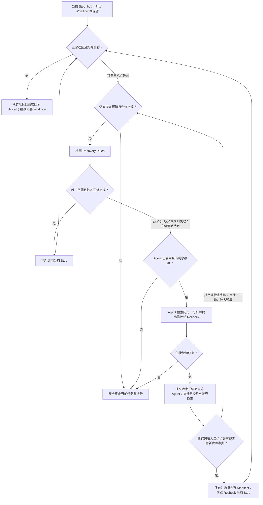

# Stage 3.5: Agent Runtime Step Recovery and Maintenance

Status: deferred from Stage 3 by ADR 0025. The prior runtime architecture, including the #310 and #311 decisions, is retained as the Stage 3.5 design baseline; implementation and the recovery-ladder discussion remain future work. Stage 3.5 is not a prerequisite for the Stage 3 repair experiment.

Tracking: [GitHub Issue #322](https://github.com/HSLix/LixAssistantLimbusCompany/issues/322).
2026-10-23 阶段边界确认：Stage 3 的独立修复仅从 Default Manifest 初始化 Developer Candidate；读取运行中任务或 Plan 的 Working Manifest 并衔接修复属于 Stage 3.5，不要求 Stage 3 独立 CLI 发现或接入另一个执行中的 Run。

ADR 0028 后续确认：实时截图、受限现场裁剪新增 Asset 和按日期/UUID4 留存的独立 Agent Interaction Log 已纳入 Stage 3 的待实现范围。本阶段复用这些工具并增加运行时关联；这不表示 Stage 3 工具已完成或具备 Runtime Agent Recovery。

An Agent may help an existing supported Task Workflow only after an Execution Anomaly leaves its current Step wrapper paused. It may propose changes to Steps, Task Workflows, and Subworkflows in one complete Manifest, with reasons for the changes. Trusted Actions and Recovery Rules are outside this Agent modification scope. The Agent may propose new template Assets cropped by the executor from a fresh Target Window screenshot taken for that crop request (ADR 0020); it cannot overwrite, rename, or delete existing Asset files. Normal supported execution remains deterministic and model-free.

```text
existing supported Task Workflow
→ Execution Anomaly inside its paused Step
→ bounded Runtime Agent Session
→ complete candidate Manifest and structural validation
→ supervised permission for this execution
→ atomic selection and fresh invocation of the current Step
→ compatible return commits the whole selection, or failure pauses for another choice
→ post-execution review for separate permanent publication
```

## Confirmed scope

- Workflow execution errors outside Step, invalid root results, and Recovery Rule failures do not create new recovery boundaries. Task has no entry condition or final verifier; authors implement business checks in Steps. Agent sessions and Manifest trials remain limited to a paused Step with live callers.
- Each Agent Turn returns exactly one Working Manifest Update Proposal, `Request Step Recheck`, or Safe Task Termination recommendation. There is no Temporary Action Plan or direct model-action channel.
- `max_turns` is the Session budget. A dispatched model request consumes a Turn even when its response is invalid or its provider fails. Provider, model, System Prompt version, generation parameters, and Agent Adapter version remain fixed within the Session.
- An invalid Agent result, failed structural or compatibility check, or user rejection consumes the current Turn. Rejection requires feedback before another Turn when budget remains. Source revision receives a new immutable Component ID; there is no proposal status machine or separate revision loop.
- The Agent Adapter transports one self-contained Context Snapshot and parses one Turn result. It does not execute actions, write files, validate or select a Manifest, invoke Components, or decide recovery and termination.
- The Agent may propose several changes to the allowed Component roles in one complete Manifest. Every mapping, source identity, formal call, role, and signature must pass complete validation before selection. Prompt guidance asks for a narrow change and a reason for each edit; the exact proposal format remains to be designed.
- A proposal may be selected only while the executor can immediately make a legal, compatible fresh invocation of the paused current Step. The executor retains the existing Python caller frames and their locals. Changed Workflow implementations apply to later new calls; they never replace an entered frame.
- A user who explicitly selects an already saved Manifest ID to start an execution runs that Manifest directly. Supervised Operation requires review and explicit permission for each new complete Manifest update proposed by the Agent during that execution, before its changed code executes. That permission applies to the complete selected Manifest for this execution, including later calls; it neither permanently publishes the Manifest nor changes the Default Manifest.
- The Supervised Review Dialog is topmost and modal. It blocks main-window interaction until the supervisor approves the complete proposal for this execution, rejects it with feedback, or confirms Cancellation; its close action and Escape key cannot bypass that decision. `Request Step Recheck` and Safe Task Termination recommendations introduce no candidate source and require no source confirmation.
- After selection, changed Steps, Task Workflows, and Subworkflows execute through the ordinary Component path with their ordinary Trusted Action permissions. The first current-Step call is the behavioral trial. A compatible return commits the whole selected Manifest and resumes paused callers; the Task Workflow continues its remaining Steps and succeeds only on a normal compatible return.
- If that current-Step call fails, execution remains paused. The Agent may select any durably retained attempt Manifest ID as the basis for another modification and trial, or end the execution. No automatic rollback occurs. A later Step failure after a successful return is a new interruption at that Step and leaves the committed Manifest selected.
- Every complete Manifest used for an attempt is durably saved with a Manifest ID, including the original and intermediate versions. Intermediate attempts remain available as history after execution, without separate user approval. Trying an existing Manifest again uses its existing ID and records another attempt in Trace. The Agent's Context Snapshot supplies the available IDs within its context budget; the exact context format remains to be designed.
- Ordinary Component execution is not a security sandbox. The supervisor sees the complete proposed change and residual risk before granting runtime permission. The Agent cannot directly call Trusted Actions or modify their implementations or Recovery Rules. The Agent may propose new template Assets cropped by the executor from a fresh Target Window screenshot taken for that crop request (ADR 0020); it cannot overwrite, rename, or delete existing Asset files.
- Cancellation prevents later gated work and wakes a cooperative pause without closing the GUI or Target Window. It neither enters recovery nor automatically changes the last selected Manifest.
- The GUI remains on its main thread and Task Workflow orchestration stays in one background thread. Its `threading.Condition` Run Gate waits without polling before new Trusted Actions or Agent Turns; a permitted operation finishes even if Pause is requested immediately afterward. Stop and review-window termination use the same Cancellation path.
- Runtime permission and successful trial are evidence for the separate post-execution approval decision. Saving an intermediate attempt as history does not permanently approve it, but any saved Manifest ID may be explicitly selected in a later execution. Once the current Working Manifest is approved, its permanent approval is not repeated merely because it is selected in another execution.
- If execution ends with a current Working Manifest ID that has not already received permanent approval, only that current Working Manifest is submitted for post-execution approval. Returning to the Base Manifest or another already approved ID skips repeated approval; earlier intermediate versions remain in attempt history but are not separate approval candidates. The review shows the final Task Workflow result and explicit checking-Step evidence, failure reasons when present, Trace, and Validation Coverage; failed verification does not block human approval. The topmost modal Capability Approval Dialog requires an explicit whole-proposal approve-or-reject decision. After approval, another window asks whether to set the approved current Working Manifest as Default. Trial and review evidence remain available under their retention policy.
- A process crash before post-execution approval preserves attempted Manifest IDs and flushed evidence but does not automatically reopen an approval dialog on restart. Any saved ID remains explicitly selectable. Independently, explicitly setting any saved ID as Default requires no additional confirmation, regardless of permanent approval status.
- New immutable source files and screenshot-derived Assets are stored directly in their normal libraries, while attempted Manifests remain available by ID. Post-execution approval and rejection retain files; resource maintenance is deferred, with no Candidate File Batch (ADRs 0020 and 0021).

## Deferred

- Agent-assisted Workflow Drafting for a new objective, unsupported goals, and autonomous Capability Expansion.
- Independent single-Component repair outside an active task is now Stage 3, specified in [Agent-assisted Component Repair](stage-3-agent-assisted-component-repair.md); it is not part of the #310/#311 runtime path.
- Cross-Workflow continuation, frame reconstruction, and Checkpoint/Resume; revisit them only when a real case shows why current-Step recovery cannot complete a task.
- Continuing after an already returned Task would require a separate continuation contract. Current execution never reconstructs its caller frame or replays the completed Workflow.
- Unattended Operation, a high-risk action taxonomy, and direct model actions.
- Concrete Agent proposal and Context Snapshot formats, persistence paths, and UI details.
- TODO for Stage 3.5: during Manifest validation, attempt to derive Component → Component calls and Component → Asset references, and provide Asset → Component reverse queries. Publish must reuse the same analysis path as validation. Associate results with the selected Manifest/library context, expose queries by Component or Asset logical name, and automatically supply relevant relationships when the Agent inspects or proposes changes to either. Derive the reverse mapping from forward references rather than independently maintaining a second source of truth; mark references that cannot be determined statically as unresolved, not as proof of no dependency. Preserve validation's existing no-publication/no-Manifest-ID side effects; this is analysis/context tooling, not a new manually authored dependency schema.
- Stage 3 evaluates Deep Agents or a similar SDK for independent repair. TODO for Stage 3.5: evaluate integrating LangChain [Deep Agents (`deepagents`)](https://github.com/langchain-ai/deepagents) for the project's open-ended Agent tasks, including its built-in tools/interfaces and a [custom backend](https://reference.langchain.com/python/deepagents/backends) to constrain exposed file/tool operations. Experimentally check its fit with the executor-owned actions, human approval, existing-file restrictions, and Turn budget before committing to adoption; this is not a dependency or implementation requirement of #321.
- Research TODO for Stage 3.5: study [Stagehand](https://github.com/browserbase/stagehand), focusing on combining deterministic operations with self-healing, caching reusable operations, and reducing model calls. Evaluate which ideas transfer from browser automation to this project's game observation and Workflow recovery; record applicable mechanisms and limitations before deciding on adoption.
- ADR 0027 replaces same-name/language duplicate rejection: full-hash images coexist under the logical name, tags are replaced as a complete list and existing image bytes are never overwritten. A new image is visible to the next match in the current Run without a Manifest proposal or publication. The future Agent path must preserve provenance, permission checks and original errors; this is not implemented Stage 3 Asset permission.
- TODO: expose an executor-owned function listing all currently available Trusted Actions, including each logical name, callable signature, required parameters and defaults, observe/control classification, and existing function/module docstrings, so developers and the Agent can inspect usage like a tool list. Derive the list from the authoritative registration rather than maintaining duplicate descriptions; registration is application-owned and shared across Manifests under ADR 0023; Manifest switches cannot change the available actions or their classification.
- TODO for Stage 3.5: define the Agent request/response path for requesting a fresh screenshot crop, receiving and inspecting the cropped Asset image, and then submitting repair code and a complete candidate Manifest. Specify how these exchanges fit the three allowed final Turn results and consume `max_turns`; Stage 2 supplies only deterministic cropping/storage and an inspectable image reference, without a model service.

The current Step is the only recovery continuation point. Changed Workflow code applies to later ordinary calls. Task has no entry-condition or final-verifier callback; business checking Steps use ordinary recovery.

Model requests have no automatic elapsed-time interruption. Cancellation remains an explicit control request and the Adapter propagates actual provider failures with their original diagnostics. There is no Session deadline, action budget, candidate budget, or plan timeout. Exhausting the existing `max_turns` budget makes the parent executor perform Safe Task Termination; user Cancellation starts no further Turn.

## Stage 3.5 architecture discussion TODO: revise Recovery Ladder

Discussion TODO only: the following proposal does not yet replace the accepted current-Step recovery baseline above or change implementation.

Retain ordinary Python Workflows and their call stacks; do not introduce externalized execution state or arbitrary Step jumps. Discuss the following recovery order:

1. **Step-level Recovery:** first use existing Recovery Rules to attempt recovery of the current Step.
2. **Task-level Recovery:** if Step recovery fails and the Task Workflow explicitly declares `restartable=True`, unwind the original Python call stack in a controlled way, use deterministic recovery operations to return the game to its main screen and verify that state, then execute the same Task again using the current Working Manifest. Every Task Workflow must explicitly declare `restartable=False` or `restartable=True`; do not supply an implicit default.
3. **Agent-assisted Recovery:** if deterministic recovery fails or the Task does not allow restart, let the Agent analyze the game state, execution Trace, and related Components. Controlled modifications produce a candidate Manifest; after user approval, select Step Retry or Task Restart, respecting the Task's restart permission. The discussion must specify when Step Retry remains available after stack unwinding without reconstructing a discarded frame.

The executor manages the entire recovery process and records it in Trace. Safely terminate when recovery ultimately fails. All recovery attempts share the unified recovery budget; do not introduce a separate `max_restarts`. Within an Automation Plan, recover only the current Task and never restart the entire Plan. Budget accounting and the transition from the current Step-only Agent boundary remain architecture discussion work.

## 2026-10-25 待讨论：保留调用栈的恢复、终结式试运行与历史检索

以下是设计评估后的讨论输入，不是已接受决定，不修改上面的 Confirmed scope，也不表示运行时 Agent 已实现。与前一节 Task Restart 提案并列讨论：一旦退出原调用栈，不能再使用这里的直接返回机制。

### 1. 当前 Step 的恢复调用作为本次 ctx.call 的完成

- 合理的核心：在当前 Step wrapper 内捕获可恢复的执行失败，保留外层 Task/Subworkflow 的 Python 帧、局部变量、原输入和调用位置。Recovery Rule 修复环境后重新调用当前 Step；Agent 提案经完整校验、兼容检查和人工运行许可后，由执行器调用替换版本。试运行正常返回且满足原返回契约时，将实际返回值交回原 ctx.call，不再重复执行一次。失败 Step 自身的帧已经退出，不能从其内部某行恢复。这是进程内的恢复边界，不是可在进程终止后重建的持久化 checkpoint。
- 边界修正：并非任意 ctx.call 报错都能成为新恢复点；当前基线只允许 Step 边界。Workflow 自身异常、Recovery Rule 失败、取消和输入释放失败不能笼统当成可重试的 Step 异常。用户暂停/接管沿原有手动恢复路径处理。
- Working Manifest 应在合法试运行前整体保存并选择，成功兼容返回后确认这次选择；失败保留已选版本和尝试证据，不把游戏状态视为自动回滚。中间 Manifest 按 ID 留档并可显式再选，已有基线已支持这一点；留档不等于永久审批，不应为留档自动授予 Publish/永久批准或修改 Default。
- 当前 Task/Subworkflow 帧继续执行其原版本。后续 ctx.call 通过最新 Working Manifest 查找被调用的 Step/Subworkflow，不会把正在执行的 Task 换成新代码；Task 不能通过 ctx.call 调用另一个 Task。后续独立 Task 调用使用其执行上下文当时选择的 Manifest；新 Top-level Execution 仍按显式选择或 Default 确定 Base，不继承上次 Run 的 Working Manifest。
- “任选历史 Manifest 的任意点执行，再接回当前 Step”需要单列为扩展提案，不能由保留栈自然推出。任意源码行没有独立调用/返回契约；即使是合法 Component 入口，其成功也不保证完成原 Step 的责任。若允许辅助 Workflow/Task，需要定义输入、调用角色、结果与原 Step 的映射、对外层局部值/游戏状态的影响和恢复嵌套归属；当前 Step 不允许调用 Component，Task 嵌套也不合法。优先讨论复用受限的当前 Step Recheck，扩展不能默认绕过这些约束。

### 2. 试运行作为结束本轮 Agent 的控制权交接

- 可以把提交 Recheck 作为本轮终结动作：Agent 交回控制权，执行器先完成必要的校验、兼容检查和变更审批，再执行当前 Step。这里结束的是本轮交互，不是终止父 Run 或整个 Runtime Agent Session；Agent 正常结束、revise_success 或自然语言成功声明都不能替代执行证据。
- 试运行成功直接向暂停调用者返回实际结果；失败将新的异常、截图和 Trace 关联交给后续恢复决策。试运行成功后不再等待 Agent 继续修改或操作游戏，否则原成功结果是否仍适用需要重新判断。
- 在 Agent Interaction Log 与 Execution Trace 中建立双向关联：父 run_id、暂停 Step 的 call_id、Agent Session/轮次、Manifest ID，以及具体试运行的 attempt/call 标识。仅 run_id 不能区分同一 Run 中多次试运行。优先把 Recheck 记为父 Run 内的一次调用尝试；若另设子 Run，必须定义父子关联、执行上下文与返回交接，不能启动一个无关 Run 后假定可续栈。字段名、分配时机、拒绝/取消时无实际执行的记录方式待定。
- 需要重新讨论旧基线“每次模型请求消耗一个 Agent Turn”与当前 Stage 3 多工具交互/对话轮次的对应关系，不能把结束一轮、结束 Session 和执行器完成一次 Step 混为一谈。

### 3. 恢复循环草案与退出条件

用户提出的 Rule → 当前 Step 重试 → Agent → Recheck → Rule 循环合理作为候选流程，但不能无界重复。待明确重复命中同一 Rule 且无进展时的升级规则、规则检测/执行错误及多规则同时命中的处理、每次尝试的归属和统一预算计数。已有 max_turns 仅计模型请求，无法单独约束不调用模型的 Rule 循环；沿前节讨论统一恢复预算，不直接增加一套独立重试配置。



图中取消从任何等待/执行位置进入现有 Cancellation 路径，不进入恢复循环；用户暂停/接管及输入释放失败也不走图中普通失败边。Recheck 请求若没有修改则使用当前 Manifest。成功后的后续 ctx.call 使用更新映射，已进入的帧保持原代码。图中的升级与重复策略仍是待讨论项，不能据此宣称现有实现已有此循环。

### 4. 从原始交互历史开始的无 embedding 检索基线

- 建议先实验只读 grep/rg 检索已脱敏的 Agent Interaction Log，按 Component 逻辑名、异常文本、Asset 名及 Manifest ID 查找，返回命中位置、相邻上下文和原记录引用；按需查看关联 Trace/截图。复用原始留存，不先建立另一份摘要记忆或向量数据库，检索结果仍只是诊断证据。
- 参考 [Is Complex Agentic Memory Always Needed? Naive RAG Is Stronger Than We Thought](https://arxiv.org/abs/2610.30755)（[方法全文](https://arxiv.org/html/2610.30755v1)）。其 Raw-RAG 使用原始历史上的 dense retrieval 与 reranking；它支持保留原始证据、先设简单检索基线的动机，不能作为“不做 embedding 的 grep 已被证明同样有效”的理论结论。这里的无 embedding 方案是本项目待验证的工程简化。
- 讨论返回条数/文本预算、上下文扩展、历史先后与版本差异、日志清理后引用失效，以及同义表达/纯图像信息无法被关键词命中的限制。用少量真实修复历史检查相关证据召回、误命中、检索耗时与实际修复帮助，再决定是否需要语义检索；不把未检索到当作从未发生。

### 5. Plan 改为 Python、参数化循环与 Plan 层恢复

2026-10-25 开发者提出以下后续讨论事项，尚未接受为执行契约，不纳入当前 Developer Policy 实现；当前 plan.json 仍只读，现有 Automation Plan 语义继续有效。

- 提案：以 plan.py 取代 plan.json，将任务循环编写在 Plan 的 Python 代码内，循环次数作为调用参数传给 Plan；外部调用 Plan 也统一使用 ctx.call。
- 目标：Plan 层自身出错并触发 Agent 介入后，允许执行器接续修复后的新 Plan，而不把恢复能力限制在其内部 Step。
- 待明确：Python Plan 的身份、不可变源码与 Manifest 归属、入口/输入/返回契约、允许的调用关系，以及 ctx.call 的外部调用者。当前 Plan 不是 Component、没有执行栈，Task 也不能调用 Task；此提案改变这些边界，不能直接套用现有 ctx.call 即视为成立。
- 待明确：“接回新 Plan”指重试完整 Plan 入口，还是从保留调用者处接收替换调用的返回值；失败 Plan 自身已退出的帧不能原地替换。需要定义已完成任务与循环进度、局部值和结果如何处理，避免重放已产生的游戏副作用；不能默认恢复到任意源码行。
- 后续统一评估 Plan 层 Agent 触发、Working Manifest 选择、监督审批、取消、恢复预算及 Trace 归属，与本节保留栈恢复和 Task Restart 提案的关系。本次仅记录议题，不新增 Runtime Policy 实现。

### 影响与后续验证

- 已检查的实现：runtime.py 的 _invoke_step 保留外层调用链，_try_manifest_choices 在原链内调用替换 Step 并校验结果，_replacement_problem 限制续接契约；_recover_step 当前最多重试一次，即使无规则匹配也会重试，并未实现本节的重复 Rule/Agent 循环。tests/test_recovery.py 已有保留调用者、后续调用使用新映射和失败版本留档的测试源码，本次未执行。
- 若采纳，需协调 CONTEXT.md、Stage 2 执行契约、Stage 3.5 Confirmed scope、ADR 0015 的审批边界和既有恢复阶梯讨论，随后修改 runtime/application 的恢复调度、Agent 协议/日志和监督 GUI。任意 Component 辅助执行涉及额外角色权限与返回协议，不能作为普通 Recheck 的小改动处理。
- 最小验收证据应覆盖：原调用者只进入一次且局部值保留；成功试跑结果只交付一次；已进入帧不替换而后续调用采用新映射；失败试跑保留 Manifest/游戏副作用事实；重复规则能退出/升级；审批拒绝、取消和预算耗尽；同一 Run 多次尝试可从交互日志准确追溯。真实模型与真实游戏状态衔接另行验收，静态校验或假环境测试不能代替。
