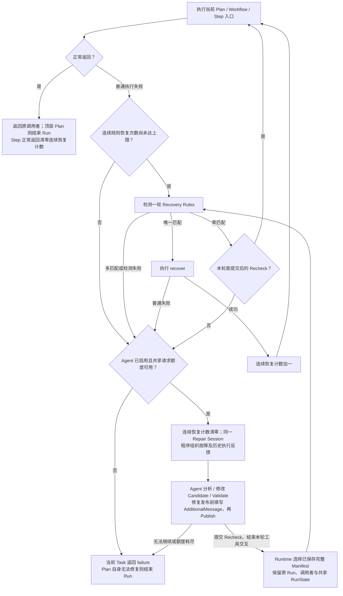
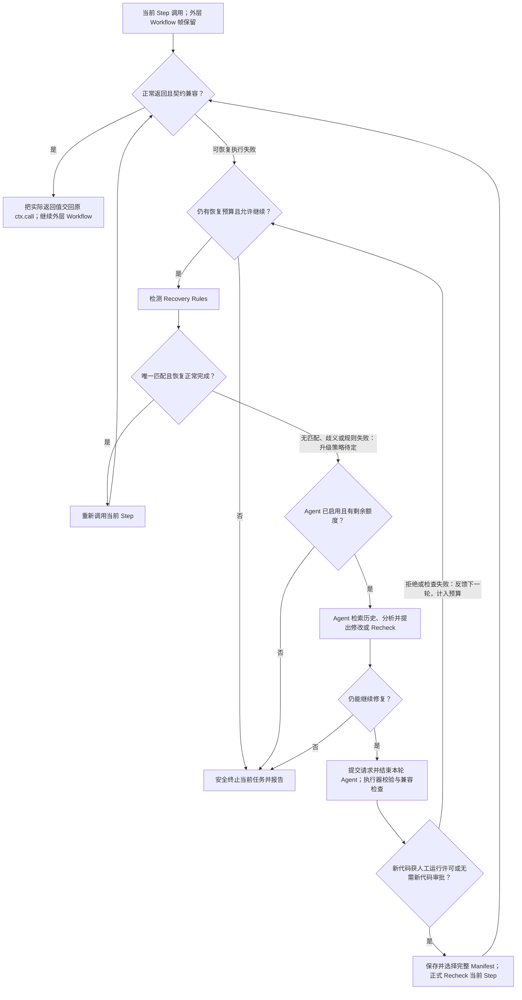

# Stage 6（原 Stage 3.5）：Agent Runtime Maintenance

## 2026-11-11 设计讨论：已确认边界

以下是本轮逐项确认的目标契约；2026-11-11 开发者已授权进入影响审查。取舍见 [ADR 0040](adr/0040-share-run-state-and-reuse-agent-sessions-for-runtime-repair.md)，差距、迁移及待反馈事项见[影响报告](stage-6-design-impact-review.md)。本地实施与验证见[实施记录](stage-6-implementation.md)，Windows、真实模型与游戏尚未验收；下文旧基线在相抵触的范围内由本节替代，其他未被明确替代的权限、校验、审批与中断约束继续保留。

- Stage 6 支持 Workflow 自身调度失败的修复，不再仅限 Step。Step 内失败归属 Step；Workflow 自身调度失败归属对应 Workflow，不采用下层恢复失败后自动逐层重启外层的设计。修复后重新进入对应入口，实际返回交回仍在等待的调用者；不恢复失败函数内部任意代码行。
- 引入 RunState，承载同一次 Run 内可由 Plan、Workflow、Step 修改的运行配置和必要业务进度；以现有 `task_repetitions`、`settings` 为设计起点。业务代码自行决定字段含义、更新时机及重新进入后的行为，框架不解释队伍轮换、剩余次数或推断业务重放策略。
- **RunState 仅驻留内存，生命周期为一次 Run。** 同一 Run 内调用及恢复保留该状态；Run 结束即结束，不落盘，不支持据此恢复进程退出前的 Run，也不自动继承到新的 Run 或回写用户配置。原有 Trace 等证据留存不因此移除。
- RunState 允许业务代码直接修改共享对象（例如 `ctx.run_state.settings["team"] = "B"`）；修改立即对后续读取生效，即使当前调用随后失败也保留，不增加显式提交或失败自动回滚；游戏状态与内存状态的一致性由业务代码负责。
- 已确认将 Plan 的 `task_repetitions`、`settings` 两个入口参数迁入 `ctx.run_state`，Plan、Workflow、Step 均从同一 RunState 读取和修改这些数据，不再由 Plan 层层传递整套配置。普通业务参数仍经 `ctx.call()` 显式传递并遵循原有独立副本与重试参数快照规则；框架不根据最新 RunState 自动重算调用参数，业务代码自行决定何时读取共享状态。此决定改变正式 Plan 入口契约；应用启动时统一初始化 RunState，旧 Plan 的迁移按下一条已确认决定执行，不据此宣称已迁移现有源码。
- 已确认 **不保留旧 Plan 参数接口兼容层**：旧 Plan 源码须改为通过 RunState 获取原配置数据，并校验、重新发布后用于新契约；不自动重写既有不可变源码／Manifest，不靠兼容分支继续执行旧签名。仓库样例、测试夹具、开发指导、生成声明及运行入口受影响范围由后续审查逐一核对。此决定仅针对正式 Plan 入口，不直接等同于移除应用启动时初始化 RunState 所需的数据输入。
- 所有 Run（包括直接 Task／Subworkflow／Step 入口及 Developer Trial）统一在启动边界初始化自己的 RunState，普通调用参数另传，不让非 Plan 入口绕过状态初始化。连续恢复上限与“运行成功后自动使用修复版本”选项在 Run 开始固定，本 Run 不因设置保存而改变；历史检索及人工反馈开关仍按已确认的下一轮 Agent 生效。
- 删除旧运行后永久批准流程，不再提供独立 Capability Proposal／Capability Approval Dialog，也不维护额外永久批准状态作为已发布版本的使用门槛。完整 Validate、不可变 Publish、当前 Run 选择及正常结束后的 Default 更新承担各自职责；开发页面安装等其他审批不因此取消。此决定替代 ADR 0016 及旧基线中相应运行后批准条款。
- Recovery Rule 的 `detect`、`recover` 均可访问和直接修改同一 RunState，不对 RunState 增设角色／阶段读写限制；`detect` 的修改也立即共享且失败不回滚。此决定仅放宽共享业务状态访问，不改变 Trusted Action 的 observe/control 权限；原有“只读检测”在禁止修改 RunState 的含义上被替代，影响审查需同步相关术语与规格。
- Runtime Agent 获准通过专用只读工具查看当前 RunState，由宿主返回查看时的状态快照，不交付可变 Python 对象；首版不提供 Agent 修改 RunState 的工具或直接写入权限。此边界不取消正式业务代码已确认的读写权限，修复源码的执行仍遵守单独的校验和执行边界，不再要求下述已取消的逐次人工批准。
- Plan 自身调度失败时，同样在对应边界修复，并在同一 Run 内重新调用修复后的 Plan 入口，保留当前 RunState 及此前实际产生的任务记录；不创建新的独立 Run，不恢复原 Plan 内任意报错行。Plan 自行依据 RunState 决定后续调度，正常返回后结束本次执行。此决定替代旧讨论中“Plan 报错直接结束”作为 Stage 6 行为的限制，不改变当前尚未迁移的实现事实。
- 取消 Runtime Agent 修复后新 Manifest 执行前的逐次人工审批流程：完整校验及恢复入口合法性检查通过后可自动选择并执行，不因有人／无人值守而要求源码批准。此决定替代 ADR 0015 及旧基线相应的 Supervised Review／运行许可要求；不取消用户 Stop、暂停／接管、既有工具权限或必要的校验，也不顺带取消开发页面安装等其他审批。现有 Python 执行不具备安全沙箱保证，不将自动执行描述为具备隔离。
- Runtime Agent 修复后须在 Publish 前，于候选 Manifest 现有 `AdditionalMessage` 字段简要说明本次修复的问题，再发布不可变版本；不能省略或仅保留与本次无关的旧说明。复用现有说明字段，不新增平行元数据；版本说明不是修复已成功的执行证据。当前该字段允许缺省／空字符串，现有 `publish()` 未强制修复说明，需在运行时发布接入时落实本要求，不据此要求所有历史版本补填。
- User GUI 的 Agent 设置新增“**运行成功后自动使用修复版本**”选项，**默认开启**；关闭时 Runtime 修复版本仅供本次 Run 选择使用，不自动更新 Default。本选项不改变通用 Publish 的职责，也不授予 Developer Agent 设置 Default 的工具权限。此文案替代原“自动将修复版本设为 Default”，界面实现及中英文翻译须同步。
- 2026-11-11 开发者修订：仅在 **Plan 正常结束后**（直接 Component Run 须正常成功返回），检查该 Run 最终 active Manifest（即当前 Working Manifest），据此更新 Default；替代此前无论结果都更新的决定。Plan 仅须 `status == "completed"`，**不要求 `all_tasks_succeeded == true`**；直接 Component Run 须为 `status == "success"`，且完成输入清理和必要记录后无收尾故障。取消、Plan 中断、直接 Component Run 失败、清理或必要持久化故障均不自动切换；Plan 正常结束即使含失败 Task 也可切换。仍不按最新发布时间选择，也不在发布或单次恢复调用返回时切换。成功写入 Default 后 GUI 显示切换成功提示，写入失败单独提示，不改变执行结果及旧 Default；无需切换时不提示。一次 Run 成功不等于整份版本已全面验证。
- Runtime Agent 可以像维护普通 Manifest Component 一样修改、新增 Recovery Rule，并登记到候选 Manifest；规则随完整 Manifest 校验、发布和运行选择生效，不再属于禁止修改范围。新增／修改仍遵守 Recovery Rule 的入口、调用关系和 Trusted Action 权限，不授权修改应用内置规则或 Trusted Actions；此前 Runtime 无删除工具和权限的边界继续保留，不从“添加等”推导删除授权。当前 `_replacement_problem` 一律拒绝 `recovery_rules` 变化的检查须随实施调整。
- 已确认选择修复后的 Manifest 后、重新调用失败 Component 前，默认完整检测一轮 Recovery Rules；按匹配结果执行适用恢复，再重新调用该 Component。一次检测不会因恢复规则执行过就自行反复检测；Component 再次失败则重新进入统一恢复流程，受已确认的恢复计数及 Agent 额度约束。
- 普通执行失败进入恢复流程后，若没有 Recovery Rule 匹配，则交给 Agent；Agent 提交 Recheck、选择修复版本后的规则检测若零匹配，直接重新调用当前修复入口。该调用再次失败时仍走统一恢复流程，不另设直接反馈 Agent 或跳过规则检测的专用失败路径；达到连续恢复上限时仍按已确认的规则转交 Agent。
- 多条 Recovery Rule 同时匹配时报告歧义，将匹配规则信息交回 Agent 分析，不自动任选规则或依次执行多条恢复；该轮不据此继续重新调用失败 Component。检测阶段已发生的 RunState 修改仍遵守不自动回滚的约定。
- Recovery Rule 的 `detect` 或 `recover` 自身普通执行报错时，将错误及规则信息交回 Agent 修复，保留原失败 Component 为待续接入口；选择修复版本后重新检测一轮规则。取消及无法继续的环境／必要持久化错误仍沿既有中断路径处理。
- 已确认允许修复失败后继续修复，在同一个恢复会话中循环，不递归创建新的 Agent 会话。提交 Recheck 结束的是本轮 Agent 工具交互、将控制权交还 Runtime，不是结束恢复会话或父 Run；Recheck 普通失败时继续由该恢复会话处理，规则歧义／自身报错按上文反馈 Agent。成功的实际返回只交付原调用者一次，之后发生的独立失败不再属于已完成的恢复点。
- Runtime Agent 的执行请求仅支持当前恢复点的 Recheck，即重新调用本次失败的 Plan、Workflow 或 Step 入口；不开放 Developer 的独立 `trial_run`，不能另选无关入口试运行或借此改变待续接入口。Recheck 属于原 Run，沿用原调用参数快照及最新共享 RunState，遵守已确认的规则恢复和预算边界；当前恢复点成功后实际返回交付一次，不另起 Run 再假定可以接回原调用者。Developer Policy 的独立试运行能力不因此移除。
- Session 采用同一套现有 Agent Session：复用身份、来源 Manifest、Candidate、固定比较基线、对话、工具循环和日志，以介入时 active／Working Manifest 的已发布 ID 作为新 Repair Session 的初始来源，由既有候选初始化能力复制出可编辑内容。程序组织初始故障 Prompt 和修复过程中的执行反馈，不另建平行的 Runtime Session／Repair Process 抽象。各 Session 自有 Candidate，不覆盖其他开发草稿。Runtime 入口仍按本轮约定配置工具权限，复用 Session 不继承 Developer 的独立试运行、删除等权限。
- Run 结束后，该同一 Session 出现在 Developer GUI，可打开并继续修复，无须复制为另一种会话。后续交互按 Developer 入口计算权限，已结束 Run 的 RunState 和 Recheck 能力不随会话留存而复活；保留来源、修改及执行反馈作为历史。父 Run／恢复点与轮次、版本的关联复用现有日志机制扩展，不为接续另建一套状态模型。
- 修复内容及调用约定的调整由 Agent 决定，不新增修复前后签名、参数默认值或返回类型必须一致的硬性兼容检查；Skill 建议“非必要不修改调用约定”，不将建议转换为宿主拒绝规则。现有 `_replacement_problem` 对原 Step 参数／返回类型一致性的强制检查需相应调整。保留完整 Manifest 校验、合法调用关系及普通参数绑定／返回校验；无法按原参数快照调用或后续调用者使用新结果报错时，按实际失败归属处理，不伪造兼容或自动重写原调用者帧。此授权不改变仅重调当前失败入口的范围。
- Runtime Agent 复用现有只读参考能力：知识库读取／搜索、Skills、历史 Agent 记录及关联运行日志；参考内容不构成新授权，不由此开放知识库修改或同步工具。历史 Agent 记录访问另受下述全局开关控制。
- 开发者后续撤销专用素材反向引用工具及配套分析文件需求：本阶段不做 Component 调用图、正向素材查询或专用反向引用索引；Publish 不额外生成引用分析文件，查询旧 Manifest 也不新增补建流程。Agent 复用现有素材查看、Manifest 成员与源码读取工具自行定位引用；不承诺自动穷尽动态引用。此决定替代本轮短暂提出的发布分析／查询补建方案，也不恢复历史通用依赖分析 TODO 为本阶段前置。
- Developer GUI 的 Agent 设置新增“允许检索历史 Agent 记录”总开关，**默认开启**，统一约束 GUI Construct／Repair、CLI Repair 及 Runtime Agent 等所有模式和入口；开启后才允许历史检索，关闭后所有 Agent 均不得检索历史 Agent 记录，不能由其他模式或直接读取历史详情绕过。此开关控制历史参考访问，不删除已有日志或停止新日志记录；当前会话正常续聊上下文不等同于检索历史记录。**修改从下一轮 Agent 开始生效**：沿用每轮开始时固定设置和权限、工具调用时检查该轮白名单的机制，不增加每次调用重新读取 GUI 设置的动态权限检查。当前轮继续使用已固定的权限；Runtime 的多轮恢复不因重新固定权限而重置该恢复会话的共享请求额度。
- User GUI 的 Agent 设置增加“允许请求人工反馈”开关，**默认关闭**，作为 Runtime 人工反馈的明确值守权限来源，不由框架猜测用户是否在场。开启时 Runtime Agent 可请求人工答复或操作并等待反馈，关闭时不提供该工具；不影响 Developer GUI Construct／Repair 原有人工反馈能力。**修改从下一轮 Agent 开始生效**，当前轮沿用固定权限，已发出的反馈请求仍可答复或跳过，不因关闭开关立即结束等待；显式取消仍沿现有取消与工具收尾路径处理。
- RunState 增加框架自动维护的连续恢复计数：Run 初始为 0，Recovery Rule 的 `recover()` 正常完成后加 1，Step 正常返回或恢复流程实际交由 Agent 介入时清零；检测匹配、发布或切换 Manifest 本身不改变计数。清零发生在 Runtime 向 Agent 交接控制权时，不在每次模型请求或工具调用时重复清零。**该框架计数对业务代码只读**，不受前述业务配置自由修改授权覆盖。该计数限制两次 Agent 介入之间无意义的“规则恢复—执行失败—规则恢复”循环，不是整个恢复会话的累计预算，也不是 Python 调用栈的嵌套深度；不采用前述“同一版本规则仅能成功恢复一次”的建议。
- 内置游戏崩溃规则成功完成恢复时，同样计入上述连续恢复次数；**移除每个 Run 最多自动重启游戏一次的独立限制**，不再维护单独的重启次数上限。再次确认游戏进程退出时按统一连续恢复预算处理，不仅因本 Run 曾重启过就终止。此决定替代 ADR 0039 的每 Run 一次限制；不取消进程退出确认、窗口重新绑定、用户接管／取消及重启失败属于无法继续环境故障的边界。当前 `_automatic_restarts`／`game_restart_limit` 实现及对应测试、文档需在影响审查后统一调整。
- 连续恢复次数上限在 **User GUI 设置中可查看、修改，默认 10**。达到上限且执行仍失败时，不再继续确定性规则恢复，转交同一恢复会话中的 Agent 并清零连续恢复计数，后续受该会话共享的 Agent 请求额度约束。Agent 提交 Recheck 后正常检测一轮 Recovery Rules，不新增“规则额度耗尽后跳过规则”的专用路径；再次失败仍进入统一恢复流程。未启用 Agent 或其请求额度耗尽时，按既有失败出口处理，不以清零方式继续确定性恢复。该上限在 Run 启动时固定。
- 同一恢复会话内的 Agent 多轮修复、Recheck 失败反馈共用 `max_requests` 额度，不因重新进入 Agent、发布或切换 Manifest 重置。Agent 设置的 `max_requests` 默认值由 20 调整为 **50**；默认值调整不覆盖用户已保存的显式配置。源码默认已更新为 50；确定性规则恢复不消耗模型请求额度，其连续恢复上限仍单独计数。
- Agent 请求额度耗尽、无法继续修复时，结束当前 Task，沿用 Plan → Task 的执行结果封装，向等待的 Plan 返回 `task["status"] == "failure"` 的结果对象并保留失败诊断；不把它作为业务 `output` 中的状态，也不因该普通失败自动重启／修复外层 Plan。Plan 自行决定后续调度。若失败且无法修复的是 Plan 自身，则结束整个 Run；取消、无法继续的环境错误及必要持久化错误仍走原有整个 Run 中断路径，不降为普通 Task 失败。
- 实施补充决策：所有启动入口增加默认 True 的 `use_saved_config`；True 采用保存的页面配置及启用任务次数，False 使用显式数据、缺省为空。Developer Trial 不启动 Runtime Agent。Default 写入失败保留执行结果及旧 Default，单独提示失败。重启恢复达到统一上限且 Agent 无法介入时终止整个 Run，无需再检查游戏是否退出。允许只读、哈希校验后复制旧版本为修复草稿，不执行旧接口、不添加兼容层。

### Grill 进度检查

核心恢复模型、RunState、审批替代、发布说明、Run 结束切换 Default、规则修复、预算／失败出口、Session 融合、工具开关及旧 Plan 无兼容层迁移均已逐项确认。开发者已授权审查；报告及文档同步已完成，开发者已授权实施；实现与测试证据见[实施记录](stage-6-implementation.md)，未创建 tickets。初始化与设置固定时点已确认，旧运行后永久批准已删除；剩余范围与实施风险以影响报告为准。

审查交接清单（已确认边界及待核对的落地事项）：

1. Runtime 工具白名单：独立 `trial_run` 已排除，仅支持当前失败入口的 Recheck；只读知识库／Skills／历史及关联日志已接受，历史参考受 Developer GUI 默认开启、下一轮生效的全局开关控制；人工反馈由 User GUI 默认关闭、下一轮生效的开关授权，已发出的请求保留答复／跳过路径。
2. Session／版本续接：已确认不强制修复前后调用约定相同，仅在 Skill 中建议非必要不修改；Runtime 使用现有 Repair Session、由程序组织故障 Prompt 与反馈，介入时以 Working Manifest 初始化 Candidate，Run 结束后同一 Session 可在 Developer GUI 接续；日志关联字段留影响审查和实施明确。
3. 恢复循环：零匹配分支已明确，Recheck 再失败统一返回恢复流程；内置崩溃恢复计入统一连续恢复次数，取消每 Run 一次的独立限制；Agent 介入清零连续恢复计数，Recheck 正常检测规则。取消期间工具收尾和 Run 结束处理留影响审查核对。
4. 数据与验收边界：旧 Plan 已确认不保留参数兼容层，需修改源码后重新发布；所有 Run 启动时初始化 RunState，连续恢复上限和自动使用修复版本选项在 Run 开始固定；父 Run／恢复点／Agent 轮次／尝试版本的日志关联及验收由实施落实。专用依赖／素材反向查询及其分析文件已明确排除。

具体工具名称、界面提示样式和计数字段命名等可留实施，不逐项升级为架构决策。影响审查需明确替代旧 Step-only、逐次审批及只读 Context 等条款；随后应用一致的现行规格和必要 ADR，开发者反馈修订后再拆分 tickets。

## 当前恢复流程（目标契约）

恢复入口是当前失败的调用，不是“保存的 Manifest 版本”。原参数快照不随 RunState 更新自动重算；当前入口成功后实际返回仅交付一次，外层已进入帧仍执行原代码，后续新调用解析当前 Working Manifest。普通下层失败已处理至终止后向所属 Task 返回 failure，不触发外层调度修复。



图中只画普通失败：取消不启动新修复；暂停／接管、输入释放失败及必要持久化故障沿现有路径处理。确认游戏进程退出时优先内置崩溃规则，不在失去有效窗口时检测业务规则；恢复成功计入同一连续计数，不另设每 Run 重启次数。Agent 的多轮请求共享额度，即使规则计数清零也不刷新模型额度。Runtime 再次执行失败始终回到同一流程，不建递归 Agent Session。

Plan 正常结束（`status=completed`）后，按“运行成功后自动使用修复版本”选项采用最终 Working Manifest 更新 Default，并在写入成功后提示；不要求各 Task 最终全部成功。取消、Plan 中断或收尾故障不自动切换；直接 Component Run 仍要求 `status=success`。不把发布、默认切换或 Agent 输出当作执行成功证据。旧运行后永久批准流程已明确删除，不添加到图中作为执行或采用版本的门槛。

## 原基线与历史补充（以下不覆盖上面的目标契约）

2026-11-07 局部新增已接受契约：[ADR 0039](adr/0039-recover-game-process-exit-with-a-built-in-rule.md) 规定应用内置游戏崩溃恢复规则，在当前 Step 内确认绑定进程退出时优先调用 `control.restart_game` 并重新调用该 Step，每个 Run 最多一次；再次退出或重启失败终止整个 Run/Plan。失焦、最小化、未知窗口故障和用户接管仍走人工处理，Step 外不新增恢复边界。此增量不接受下文尚待讨论的通用循环、预算或 Runtime Agent 提案。过程日志及验证见[实施记录](game-restart-design.md)。

2026-10-30 追加边界：Runtime Repair 不提供删除工具或删除权限，包括开发 Repair 的 remove_asset；不因复用 Repair 继承其完整工具集。Recovery Rule 修改范围、生效与运行时修复接口等变更保留为 [Stage 6 TODO](#stage-6-todo-repair-integration)，本阶段不据此改写下文原有执行基线或放宽源码检查。

2026-10-27 Stage 4 grill 已结束：[ADR 0032](adr/0032-use-python-plans-and-coexisting-user-developer-guis.md) 接受 Python Plan 的身份、开发编辑和执行入口迁移，将这些基础工作提前纳入 Stage 4；下文 Python Plan TODO 的这部分不再待定。Plan 自身故障后的 Agent 评估/修复及试运行仍属 Stage 6，仅在 User Agent 启用时触发；续接/副作用/预算仍待讨论。其他 Stage 6 新提案不因本次同步自动接受。

2026-10-26 排期确认：原 Stage 3.5 的完整 Runtime Agent Maintenance 延后至 **Stage 6**。保留本路径以维持引用；下文 Stage 3.5 为原阶段名，Confirmed scope 和待讨论项各保留其状态。其他 Stage 4–6 新提案见[路线图规划记录](reconstruction-plan.md#2026-10-26-规划记录已确认排期与待讨论草案)，尚未接受为技术方案；下一轮 grill 聚焦 Stage 4 的重要设计和实现边界。本次不改运行时契约或代码。

Status: deferred from Stage 3 by ADR 0025. The prior runtime architecture, including the #310 and #311 decisions, is retained as the Stage 3.5 design baseline; implementation and the recovery-ladder discussion remain future work. Stage 3.5 is not a prerequisite for the Stage 3 repair experiment.

Tracking: [GitHub Issue #322](https://github.com/HSLix/LixAssistantLimbusCompany/issues/322).
2026-10-23 阶段边界确认：Stage 3 的独立修复仅从 Default Manifest 初始化 Developer Candidate；读取运行中任务或 Plan 的 Working Manifest 并衔接修复属于 Stage 3.5，不要求 Stage 3 独立 CLI 发现或接入另一个执行中的 Run。

ADR 0028 后续确认：实时截图、受限现场裁剪新增 Asset 和按日期/UUID4 留存的独立 Agent Interaction Log 已纳入 Stage 3 的待实现范围。本阶段复用这些工具并增加运行时关联；这不表示 Stage 3 工具已完成或具备 Runtime Agent Recovery。

An Agent may help an existing supported Task Workflow only after an Execution Anomaly leaves its current Step wrapper paused. It may propose changes to Steps, Task Workflows, and Subworkflows in one complete Manifest, with reasons for the changes. Trusted Actions and Recovery Rules are outside this Agent modification scope. The Agent may propose new template Assets cropped by the executor from a fresh Target Window screenshot taken for that crop request (ADR 0020); it cannot overwrite, rename, or delete existing Asset files. Normal supported execution remains deterministic and model-free.

```text
existing supported Task Workflow
→ Execution Anomaly inside its paused Step
→ bounded Runtime Agent Session
→ complete candidate Manifest and structural validation
→ supervised permission for this execution
→ atomic selection and fresh invocation of the current Step
→ compatible return commits the whole selection, or failure pauses for another choice
→ post-execution review for separate permanent publication
```

## 历史基线：Confirmed scope

- Workflow execution errors outside Step, invalid root results, and Recovery Rule failures do not create new recovery boundaries. Task has no entry condition or final verifier; authors implement business checks in Steps. Agent sessions and Manifest trials remain limited to a paused Step with live callers.
- Each Agent Turn returns exactly one Working Manifest Update Proposal, `Request Step Recheck`, or Safe Task Termination recommendation. There is no Temporary Action Plan or direct model-action channel.
- `max_turns` is the Session budget. A dispatched model request consumes a Turn even when its response is invalid or its provider fails. Provider, model, System Prompt version, generation parameters, and Agent Adapter version remain fixed within the Session.
- An invalid Agent result, failed structural or compatibility check, or user rejection consumes the current Turn. Rejection requires feedback before another Turn when budget remains. Source revision receives a new immutable Component ID; there is no proposal status machine or separate revision loop.
- The Agent Adapter transports one self-contained Context Snapshot and parses one Turn result. It does not execute actions, write files, validate or select a Manifest, invoke Components, or decide recovery and termination.
- The Agent may propose several changes to the allowed Component roles in one complete Manifest. Every mapping, source identity, formal call, role, and signature must pass complete validation before selection. Prompt guidance asks for a narrow change and a reason for each edit; the exact proposal format remains to be designed.
- A proposal may be selected only while the executor can immediately make a legal, compatible fresh invocation of the paused current Step. The executor retains the existing Python caller frames and their locals. Changed Workflow implementations apply to later new calls; they never replace an entered frame.
- A user who explicitly selects an already saved Manifest ID to start an execution runs that Manifest directly. Supervised Operation requires review and explicit permission for each new complete Manifest update proposed by the Agent during that execution, before its changed code executes. That permission applies to the complete selected Manifest for this execution, including later calls; it neither permanently publishes the Manifest nor changes the Default Manifest.
- The Supervised Review Dialog is topmost and modal. It blocks main-window interaction until the supervisor approves the complete proposal for this execution, rejects it with feedback, or confirms Cancellation; its close action and Escape key cannot bypass that decision. `Request Step Recheck` and Safe Task Termination recommendations introduce no candidate source and require no source confirmation.
- After selection, changed Steps, Task Workflows, and Subworkflows execute through the ordinary Component path with their ordinary Trusted Action permissions. The first current-Step call is the behavioral trial. A compatible return commits the whole selected Manifest and resumes paused callers; the Task Workflow continues its remaining Steps and succeeds only on a normal compatible return.
- If that current-Step call fails, execution remains paused. The Agent may select any durably retained attempt Manifest ID as the basis for another modification and trial, or end the execution. No automatic rollback occurs. A later Step failure after a successful return is a new interruption at that Step and leaves the committed Manifest selected.
- Every complete Manifest used for an attempt is durably saved with a Manifest ID, including the original and intermediate versions. Intermediate attempts remain available as history after execution, without separate user approval. Trying an existing Manifest again uses its existing ID and records another attempt in Trace. The Agent's Context Snapshot supplies the available IDs within its context budget; the exact context format remains to be designed.
- Ordinary Component execution is not a security sandbox. The supervisor sees the complete proposed change and residual risk before granting runtime permission. The Agent cannot directly call Trusted Actions or modify their implementations or Recovery Rules. The Agent may propose new template Assets cropped by the executor from a fresh Target Window screenshot taken for that crop request (ADR 0020); it cannot overwrite, rename, or delete existing Asset files.
- Cancellation prevents later gated work and wakes a cooperative pause without closing the GUI or Target Window. It neither enters recovery nor automatically changes the last selected Manifest.
- The GUI remains on its main thread and Task Workflow orchestration stays in one background thread. Its `threading.Condition` Run Gate waits without polling before new Trusted Actions or Agent Turns; a permitted operation finishes even if Pause is requested immediately afterward. Stop and review-window termination use the same Cancellation path.
- Runtime permission and successful trial are evidence for the separate post-execution approval decision. Saving an intermediate attempt as history does not permanently approve it, but any saved Manifest ID may be explicitly selected in a later execution. Once the current Working Manifest is approved, its permanent approval is not repeated merely because it is selected in another execution.
- If execution ends with a current Working Manifest ID that has not already received permanent approval, only that current Working Manifest is submitted for post-execution approval. Returning to the Base Manifest or another already approved ID skips repeated approval; earlier intermediate versions remain in attempt history but are not separate approval candidates. The review shows the final Task Workflow result and explicit checking-Step evidence, failure reasons when present, Trace, and Validation Coverage; failed verification does not block human approval. The topmost modal Capability Approval Dialog requires an explicit whole-proposal approve-or-reject decision. After approval, another window asks whether to set the approved current Working Manifest as Default. Trial and review evidence remain available under their retention policy.
- A process crash before post-execution approval preserves attempted Manifest IDs and flushed evidence but does not automatically reopen an approval dialog on restart. Any saved ID remains explicitly selectable. Independently, explicitly setting any saved ID as Default requires no additional confirmation, regardless of permanent approval status.
- New immutable source files and screenshot-derived Assets are stored directly in their normal libraries, while attempted Manifests remain available by ID. Post-execution approval and rejection retain files; resource maintenance is deferred, with no Candidate File Batch (ADRs 0020 and 0021).

## Deferred

- Agent-assisted Workflow Drafting for a new objective, unsupported goals, and autonomous Capability Expansion.
- Independent single-Component repair outside an active task is now Stage 3, specified in [Agent-assisted Component Repair](stage-3-agent-assisted-component-repair.md); it is not part of the #310/#311 runtime path.
- Cross-Workflow continuation, frame reconstruction, and Checkpoint/Resume; revisit them only when a real case shows why current-Step recovery cannot complete a task.
- Continuing after an already returned Task would require a separate continuation contract. Current execution never reconstructs its caller frame or replays the completed Workflow.
- Unattended Operation, a high-risk action taxonomy, and direct model actions.
- Concrete Agent proposal and Context Snapshot formats, persistence paths, and UI details.
- TODO for Stage 3.5: during Manifest validation, attempt to derive Component → Component calls and Component → Asset references, and provide Asset → Component reverse queries. Publish must reuse the same analysis path as validation. Associate results with the selected Manifest/library context, expose queries by Component or Asset logical name, and automatically supply relevant relationships when the Agent inspects or proposes changes to either. Derive the reverse mapping from forward references rather than independently maintaining a second source of truth; mark references that cannot be determined statically as unresolved, not as proof of no dependency. Preserve validation's existing no-publication/no-Manifest-ID side effects; this is analysis/context tooling, not a new manually authored dependency schema.
- Stage 3 evaluates Deep Agents or a similar SDK for independent repair. TODO for Stage 3.5: evaluate integrating LangChain [Deep Agents (`deepagents`)](https://github.com/langchain-ai/deepagents) for the project's open-ended Agent tasks, including its built-in tools/interfaces and a [custom backend](https://reference.langchain.com/python/deepagents/backends) to constrain exposed file/tool operations. Experimentally check its fit with the executor-owned actions, human approval, existing-file restrictions, and Turn budget before committing to adoption; this is not a dependency or implementation requirement of #321.
- Research TODO for Stage 3.5: study [Stagehand](https://github.com/browserbase/stagehand), focusing on combining deterministic operations with self-healing, caching reusable operations, and reducing model calls. Evaluate which ideas transfer from browser automation to this project's game observation and Workflow recovery; record applicable mechanisms and limitations before deciding on adoption.
- ADR 0027 replaces same-name/language duplicate rejection: full-hash images coexist under the logical name, tags are replaced as a complete list and existing image bytes are never overwritten. A new image is visible to the next match in the current Run without a Manifest proposal or publication. The future Agent path must preserve provenance, permission checks and original errors; this is not implemented Stage 3 Asset permission.
- TODO: expose an executor-owned function listing all currently available Trusted Actions, including each logical name, callable signature, required parameters and defaults, observe/control classification, and existing function/module docstrings, so developers and the Agent can inspect usage like a tool list. Derive the list from the authoritative registration rather than maintaining duplicate descriptions; registration is application-owned and shared across Manifests under ADR 0023; Manifest switches cannot change the available actions or their classification.
- TODO for Stage 3.5: define the Agent request/response path for requesting a fresh screenshot crop, receiving and inspecting the cropped Asset image, and then submitting repair code and a complete candidate Manifest. Specify how these exchanges fit the three allowed final Turn results and consume `max_turns`; Stage 2 supplies only deterministic cropping/storage and an inspectable image reference, without a model service.

The current Step is the only recovery continuation point. Changed Workflow code applies to later ordinary calls. Task has no entry-condition or final-verifier callback; business checking Steps use ordinary recovery.

Model requests have no automatic elapsed-time interruption. Cancellation remains an explicit control request and the Adapter propagates actual provider failures with their original diagnostics. There is no Session deadline, action budget, candidate budget, or plan timeout. Exhausting the existing `max_turns` budget makes the parent executor perform Safe Task Termination; user Cancellation starts no further Turn.

## Stage 3.5 architecture discussion TODO: revise Recovery Ladder

Discussion TODO only: the following proposal does not yet replace the accepted current-Step recovery baseline above or change implementation.

Retain ordinary Python Workflows and their call stacks; do not introduce externalized execution state or arbitrary Step jumps. Discuss the following recovery order:

1. **Step-level Recovery:** first use existing Recovery Rules to attempt recovery of the current Step.
2. **Task-level Recovery:** if Step recovery fails and the Task Workflow explicitly declares `restartable=True`, unwind the original Python call stack in a controlled way, use deterministic recovery operations to return the game to its main screen and verify that state, then execute the same Task again using the current Working Manifest. Every Task Workflow must explicitly declare `restartable=False` or `restartable=True`; do not supply an implicit default.
3. **Agent-assisted Recovery:** if deterministic recovery fails or the Task does not allow restart, let the Agent analyze the game state, execution Trace, and related Components. Controlled modifications produce a candidate Manifest; after user approval, select Step Retry or Task Restart, respecting the Task's restart permission. The discussion must specify when Step Retry remains available after stack unwinding without reconstructing a discarded frame.

The executor manages the entire recovery process and records it in Trace. Safely terminate when recovery ultimately fails. All recovery attempts share the unified recovery budget; do not introduce a separate `max_restarts`. Within an Automation Plan, recover only the current Task and never restart the entire Plan. Budget accounting and the transition from the current Step-only Agent boundary remain architecture discussion work.

## 2026-10-25 待讨论：保留调用栈的恢复、终结式试运行与历史检索

以下是设计评估后的讨论输入，不是已接受决定，不修改上面的 Confirmed scope，也不表示运行时 Agent 已实现。与前一节 Task Restart 提案并列讨论：一旦退出原调用栈，不能再使用这里的直接返回机制。

### 1. 当前 Step 的恢复调用作为本次 ctx.call 的完成

- 合理的核心：在当前 Step wrapper 内捕获可恢复的执行失败，保留外层 Task/Subworkflow 的 Python 帧、局部变量、原输入和调用位置。Recovery Rule 修复环境后重新调用当前 Step；Agent 提案经完整校验、兼容检查和人工运行许可后，由执行器调用替换版本。试运行正常返回且满足原返回契约时，将实际返回值交回原 ctx.call，不再重复执行一次。失败 Step 自身的帧已经退出，不能从其内部某行恢复。这是进程内的恢复边界，不是可在进程终止后重建的持久化 checkpoint。
- 边界修正：并非任意 ctx.call 报错都能成为新恢复点；当前基线只允许 Step 边界。Workflow 自身异常、Recovery Rule 失败、取消和输入释放失败不能笼统当成可重试的 Step 异常。用户暂停/接管沿原有手动恢复路径处理。
- Working Manifest 应在合法试运行前整体保存并选择，成功兼容返回后确认这次选择；失败保留已选版本和尝试证据，不把游戏状态视为自动回滚。中间 Manifest 按 ID 留档并可显式再选，已有基线已支持这一点；留档不等于永久审批，不应为留档自动授予 Publish/永久批准或修改 Default。
- 当前 Task/Subworkflow 帧继续执行其原版本。后续 ctx.call 通过最新 Working Manifest 查找被调用的 Step/Subworkflow，不会把正在执行的 Task 换成新代码；Task 不能通过 ctx.call 调用另一个 Task。后续独立 Task 调用使用其执行上下文当时选择的 Manifest；新 Top-level Execution 仍按显式选择或 Default 确定 Base，不继承上次 Run 的 Working Manifest。
- “任选历史 Manifest 的任意点执行，再接回当前 Step”需要单列为扩展提案，不能由保留栈自然推出。任意源码行没有独立调用/返回契约；即使是合法 Component 入口，其成功也不保证完成原 Step 的责任。若允许辅助 Workflow/Task，需要定义输入、调用角色、结果与原 Step 的映射、对外层局部值/游戏状态的影响和恢复嵌套归属；当前 Step 不允许调用 Component，Task 嵌套也不合法。优先讨论复用受限的当前 Step Recheck，扩展不能默认绕过这些约束。

### 2. 试运行作为结束本轮 Agent 的控制权交接

- 可以把提交 Recheck 作为本轮终结动作：Agent 交回控制权，执行器先完成必要的校验、兼容检查和变更审批，再执行当前 Step。这里结束的是本轮交互，不是终止父 Run 或整个 Runtime Agent Session；Agent 正常结束、revise_success 或自然语言成功声明都不能替代执行证据。
- 试运行成功直接向暂停调用者返回实际结果；失败将新的异常、截图和 Trace 关联交给后续恢复决策。试运行成功后不再等待 Agent 继续修改或操作游戏，否则原成功结果是否仍适用需要重新判断。
- 在 Agent Interaction Log 与 Execution Trace 中建立双向关联：父 run_id、暂停 Step 的 call_id、Agent Session/轮次、Manifest ID，以及具体试运行的 attempt/call 标识。仅 run_id 不能区分同一 Run 中多次试运行。优先把 Recheck 记为父 Run 内的一次调用尝试；若另设子 Run，必须定义父子关联、执行上下文与返回交接，不能启动一个无关 Run 后假定可续栈。字段名、分配时机、拒绝/取消时无实际执行的记录方式待定。
- 需要重新讨论旧基线“每次模型请求消耗一个 Agent Turn”与当前 Stage 3 多工具交互/对话轮次的对应关系，不能把结束一轮、结束 Session 和执行器完成一次 Step 混为一谈。

### 3. 恢复循环草案与退出条件

用户提出的 Rule → 当前 Step 重试 → Agent → Recheck → Rule 循环合理作为候选流程，但不能无界重复。待明确重复命中同一 Rule 且无进展时的升级规则、规则检测/执行错误及多规则同时命中的处理、每次尝试的归属和统一预算计数。已有 max_turns 仅计模型请求，无法单独约束不调用模型的 Rule 循环；沿前节讨论统一恢复预算，不直接增加一套独立重试配置。



图中取消从任何等待/执行位置进入现有 Cancellation 路径，不进入恢复循环；用户暂停/接管及输入释放失败也不走图中普通失败边。Recheck 请求若没有修改则使用当前 Manifest。成功后的后续 ctx.call 使用更新映射，已进入的帧保持原代码。图中的升级与重复策略仍是待讨论项，不能据此宣称现有实现已有此循环。

### 4. 从原始交互历史开始的无 embedding 检索基线

- 建议先实验只读 grep/rg 检索已脱敏的 Agent Interaction Log，按 Component 逻辑名、异常文本、Asset 名及 Manifest ID 查找，返回命中位置、相邻上下文和原记录引用；按需查看关联 Trace/截图。复用原始留存，不先建立另一份摘要记忆或向量数据库，检索结果仍只是诊断证据。
- 参考 [Is Complex Agentic Memory Always Needed? Naive RAG Is Stronger Than We Thought](https://arxiv.org/abs/2610.30755)（[方法全文](https://arxiv.org/html/2610.30755v1)）。其 Raw-RAG 使用原始历史上的 dense retrieval 与 reranking；它支持保留原始证据、先设简单检索基线的动机，不能作为“不做 embedding 的 grep 已被证明同样有效”的理论结论。这里的无 embedding 方案是本项目待验证的工程简化。
- 讨论返回条数/文本预算、上下文扩展、历史先后与版本差异、日志清理后引用失效，以及同义表达/纯图像信息无法被关键词命中的限制。用少量真实修复历史检查相关证据召回、误命中、检索耗时与实际修复帮助，再决定是否需要语义检索；不把未检索到当作从未发生。

### 5. Plan 改为 Python、参数化循环与 Plan 层恢复

2026-10-25 开发者提出以下后续讨论事项，尚未接受为执行契约，不纳入当前 Developer Policy 实现；当前 plan.json 仍只读，现有 Automation Plan 语义继续有效。

- 提案：以 plan.py 取代 plan.json，将任务循环编写在 Plan 的 Python 代码内，循环次数作为调用参数传给 Plan；外部调用 Plan 也统一使用 ctx.call。
- 目标：Plan 层自身出错并触发 Agent 介入后，允许执行器接续修复后的新 Plan，而不把恢复能力限制在其内部 Step。
- 待明确：Python Plan 的身份、不可变源码与 Manifest 归属、入口/输入/返回契约、允许的调用关系，以及 ctx.call 的外部调用者。当前 Plan 不是 Component、没有执行栈，Task 也不能调用 Task；此提案改变这些边界，不能直接套用现有 ctx.call 即视为成立。
- 待明确：“接回新 Plan”指重试完整 Plan 入口，还是从保留调用者处接收替换调用的返回值；失败 Plan 自身已退出的帧不能原地替换。需要定义已完成任务与循环进度、局部值和结果如何处理，避免重放已产生的游戏副作用；不能默认恢复到任意源码行。
- 后续统一评估 Plan 层 Agent 触发、Working Manifest 选择、监督审批、取消、恢复预算及 Trace 归属，与本节保留栈恢复和 Task Restart 提案的关系。本次仅记录议题，不新增 Runtime Policy 实现。

### 影响与后续验证

- 已检查的实现：runtime.py 的 _invoke_step 保留外层调用链，_try_manifest_choices 在原链内调用替换 Step 并校验结果，_replacement_problem 限制续接契约；_recover_step 当前最多重试一次，即使无规则匹配也会重试，并未实现本节的重复 Rule/Agent 循环。tests/test_recovery.py 已有保留调用者、后续调用使用新映射和失败版本留档的测试源码，本次未执行。
- 若采纳，需协调 CONTEXT.md、Stage 2 执行契约、Stage 3.5 Confirmed scope、ADR 0015 的审批边界和既有恢复阶梯讨论，随后修改 runtime/application 的恢复调度、Agent 协议/日志和监督 GUI。任意 Component 辅助执行涉及额外角色权限与返回协议，不能作为普通 Recheck 的小改动处理。
- 最小验收证据应覆盖：原调用者只进入一次且局部值保留；成功试跑结果只交付一次；已进入帧不替换而后续调用采用新映射；失败试跑保留 Manifest/游戏副作用事实；重复规则能退出/升级；审批拒绝、取消和预算耗尽；同一 Run 多次尝试可从交互日志准确追溯。真实模型与真实游戏状态衔接另行验收，静态校验或假环境测试不能代替。

<a id="stage-6-todo-repair-integration"></a>

## Stage 6 TODO：Repair 修改与接入

2026-10-31 Manifest 只读参考已确认：Runtime Repair 的工具白名单包含任意已发布 Manifest 内容查看，不要求先附加版本，不受有人 / 无人值守限制。复用 Stage 5 #336 的只读核心，Runtime 实际接入留本阶段；读取结构及登记源码须核验身份与路径且不导入 / 执行源码，不修改 / 切换 Working Manifest、Default、草稿或执行版本，不授权其他开发工具。人工请求是否开放仍取决于值守状态，与本条只读权限分别判断。设计及证据见[专项审查](stage-5-manifest-reference-impact-review.md)。

2026-10-31 已确认的人工交互权限：Developer GUI 中的 Construct / Repair 均开放“请求人工答复或操作并等待反馈”；User GUI 执行期间的 Runtime Repair 由 Stage 6 实现，仅有人监督 / 值守时开放，无人值守时不开放。不能因共用开发工具自动继承该权限。值守状态如何确定、何时允许变更，以及已有等待如何在转为无人值守时结束，留 Stage 6 讨论与验证；本次不实现运行时接入。

2026-10-30：以下只记录下一阶段讨论范围，不作为 Stage 5 实施项或运行时能力已接受 / 已实现的证明。**已确定的排除项是 Runtime 不提供删除工具及权限**，包括 remove_asset、通用文件删除及经其他工具绕行的删除；开发 Repair 可追溯归档删除不改变此边界。图片覆盖也未纳入需求。

- 界定运行时可维护的 Workflow / Recovery Rule 范围、工具子集和写入边界；保留 Repair 并复用其底层，不等于完整复用开发 Prompt、Publish、独立 trial_run 或工作台工具。
- 明确 Recovery Rule 修改后的校验、批准、Manifest 选择及生效时机；是否在当前 Step Recheck 前重新检测 / 执行规则，以及规则本身失败如何反馈，均留待讨论。不把允许修改规则自动解释为新增恢复边界。
- 审查 `WorkflowExecutor._replacement_problem` 当前拒绝 recovery_rules 变化的检查；何时及如何调整依赖上述决定，Stage 5 不直接移除此限制。
- 明确父 Run 的活动所有权、当前 Step 的 Recheck / 续接、取消与预算。当前 Repair 的独占活动和独立 trial_run 不能直接套入暂停 Run，不为复用而绕过已有互斥。
- 明确运行时临时草稿、完整校验后版本、Working Manifest 和已进入调用帧的关系。Candidate 只是临时草稿台，不是持久运行状态，也不是复用开发草稿的默认授权。
- 在父 Run / 修复轮次 / 尝试版本之间关联实际工具操作及日志，验证允许工具可用、删除工具不可见且宿主拒绝越权请求；覆盖取消、失败和重新选择等路径。

本轮不替代既有当前 Step 恢复边界、完整 Manifest 校验、人工运行许可、输入释放和正式源码完整性要求。
